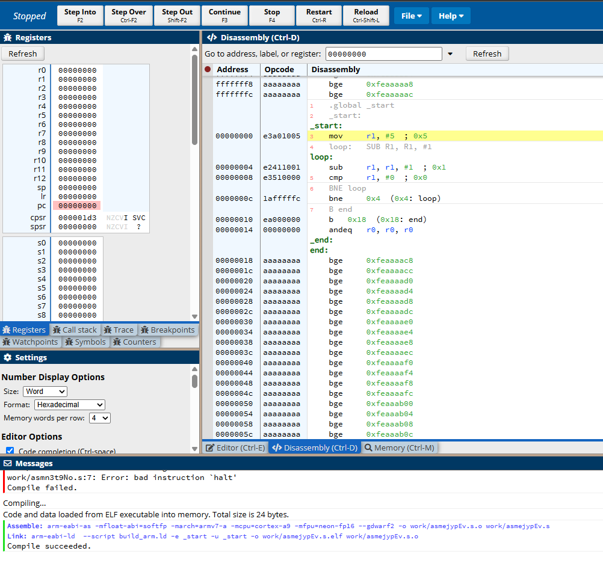

# CPU Simulator

A simple CPU built from scratch in Python to learn how a processor really works. It runs programs written in a small Arm-style assembly language, one instruction at a time, using the same **fetch–decode–execute** cycle as a real CPU.

```
python run.py programs\countdown.s --trace
```

```
PC= 0  MOV  ['R1', '#5']       R0-R3=[0, 0, 0, 0]  Z=0
PC= 1  SUB  ['R1', 'R1', '#1'] R0-R3=[0, 5, 0, 0]  Z=0
PC= 2  CMP  ['R1', '#0']       R0-R3=[0, 4, 0, 0]  Z=0
PC= 3  BNE  [1]                R0-R3=[0, 4, 0, 0]  Z=0
PC= 1  SUB  ['R1', 'R1', '#1'] R0-R3=[0, 4, 0, 0]  Z=0
...
PC= 3  BNE  [1]                R0-R3=[0, 0, 0, 0]  Z=1
PC= 4  HALT []                 R0-R3=[0, 0, 0, 0]  Z=1
Finished after 17 instructions
```

The trace shows the program counter (PC) jumping back to the loop each time, R1 counting down, and the Zero flag (Z) switching to 1 when R1 reaches 0, which ends the loop.

## What it models

- **8 registers** (R0–R7)
- **64 memory slots**, accessed with load and store instructions
- A **program counter** that points at the next instruction
- A **Zero flag**, set by `CMP` and read by conditional branches
- A **two-pass assembler** that turns text programs (with labels like `loop:`) into instructions

## Instruction set

| Instruction | Example | What it does |
| --- | --- | --- |
| MOV | `MOV R1, #5` | R1 = 5 |
| ADD | `ADD R1, R2, R3` | R1 = R2 + R3 |
| SUB | `SUB R1, R1, #1` | R1 = R1 − 1 |
| MUL | `MUL R0, R0, R1` | R0 = R0 × R1 |
| CMP | `CMP R1, #0` | Set the Zero flag if R1 equals 0 |
| B | `B loop` | Always jump to `loop` |
| BEQ | `BEQ done` | Jump if the Zero flag is set |
| BNE | `BNE loop` | Jump if the Zero flag is not set |
| LDR | `LDR R3, [R1]` | R3 = memory[R1] |
| STR | `STR R2, [R1]` | memory[R1] = R2 |
| HALT | `HALT` | Stop the program |

## How it works

| File | Role |
| --- | --- |
| `sim/isa.py` | Defines an instruction and the list of valid instructions (the ISA) |
| `sim/assembler.py` | Reads program text. Pass 1 records where each label is; pass 2 builds the instructions and replaces label names with positions |
| `sim/cpu.py` | The CPU: registers, memory, PC and flag. `step()` fetches, decodes and executes one instruction; `run()` repeats until `HALT` |
| `run.py` | Loads a program file, runs it and prints the registers (and the trace with `--trace`) |

## Running it

Requires Python 3.10 or newer. No extra packages are needed to run programs.

```
python run.py programs\add.s
python run.py programs\countdown.s --trace
```

## Testing and verification

- **Hand traces:** I traced programs on paper (PC, registers and flag after every instruction) and checked that the simulator's `--trace` output matched row by row.
- **Compared with a real Arm model:** I ran the same countdown program in [CPUlator](https://cpulator.01xz.net/?sys=arm), an online Armv7 simulator, and stepped through it one instruction at a time. The registers and the Z flag changed in the same order as in my simulator.



Differences I found between my simulator and real Arm:

- Real Arm comments use `@`; my assembler uses `;`.
- Real Arm has no `HALT`; the program ends with a branch to itself (`end: B end`).
- On real Arm the PC goes up by 4 each instruction, because each instruction is 4 bytes in memory. My simulator counts instructions 0, 1, 2…
- Real Arm can set flags from maths instructions (`SUBS`), not only from `CMP`.

Automated tests with `pytest` are in progress.

## What I learned

How a CPU runs a program through the fetch–decode–execute cycle, why registers and memory are separate (and why Arm is a load/store architecture), how compare and branch instructions combine to make loops and `if` statements, and how an assembler resolves labels in two passes. My step-by-step notes are in [LEARNING.md](LEARNING.md).

## Resources I used

- [Crash Course Computer Science](https://thecrashcourse.com/courses/the-central-processing-unit-cpu-crash-course-computer-science-7/), the YouTube series on how computers and CPUs work
- [Azeria Labs: ARM Assembly Basics](https://azeria-labs.com/writing-arm-assembly-part-1), on Arm registers and instructions
- [Arm: Learn the Architecture](https://www.arm.com/architecture/learn-the-architecture/a-profile), Arm's own guides to its architecture
- [CPUlator](https://cpulator.01xz.net/?sys=arm), for checking my programs on a real Arm model

## Next steps

- Automated tests for every instruction with `pytest`
- More example programs (factorial, summing an array, Fibonacci)
- A Negative flag and `BLT` for "less than" comparisons
